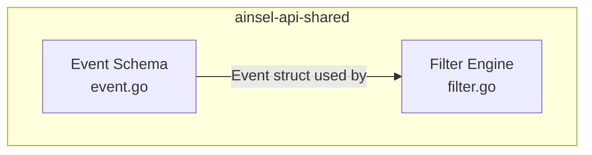
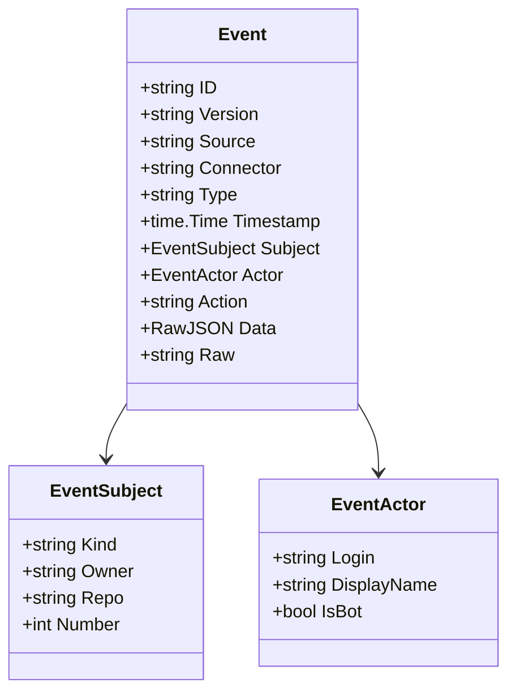
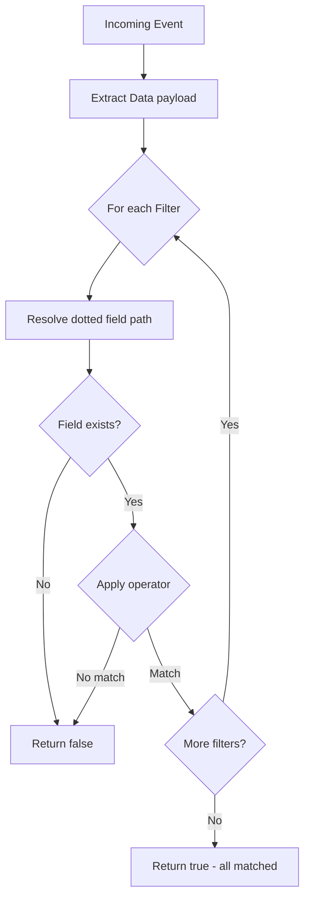

# Ainsel API Shared Architecture

## Overview

The `ainsel-api-shared` module is the shared foundation for all Ainsel platform components. It provides the canonical event schema and the filter engine, plus small naming helpers shared between the hub and the agent operator.

## Module Structure

## Event Schema

The canonical `Event` struct is the normalized format that all connectors produce and ainsel-hub-backend consumes. Every event flowing through the platform conforms to this schema.

## Filter Engine

The filter engine evaluates conditions against the event `Data` payload using dotted field paths and a set of operators. Multiple filters are combined with AND logic.

### Field Resolution

Fields use dotted notation to navigate nested JSON:
- `issue.title` resolves to `data.issue.title`
- `comment.body` resolves to `data.comment.body`

### Event Type Matching

The `MatchEventType` function supports wildcard patterns:
- `*` matches all event types
- `issue.*` matches `issue.opened`, `issue.comment.created`, etc.
- `push` matches only `push`

Event type strings live in the canonical event's `type` header (connectors
stamp it from the incoming webhook payload); see
[`docs/event-schema.md`](../../../docs/event-schema.md).
